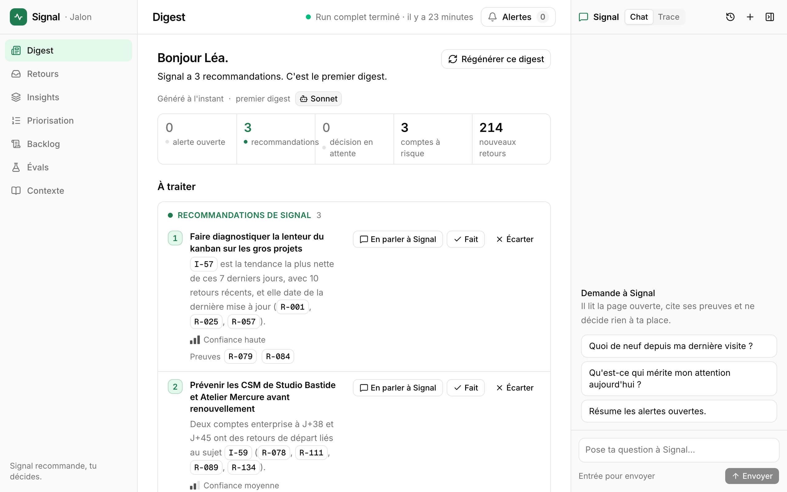
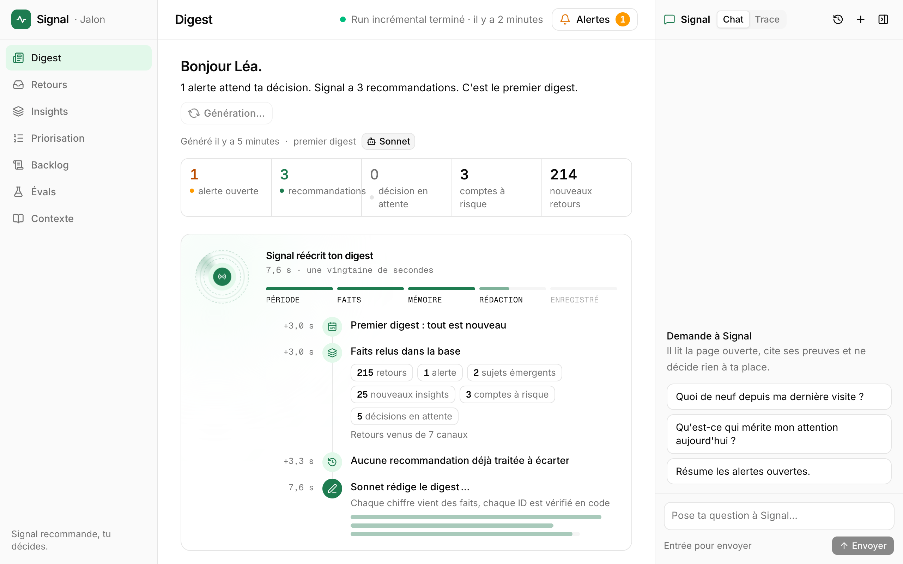
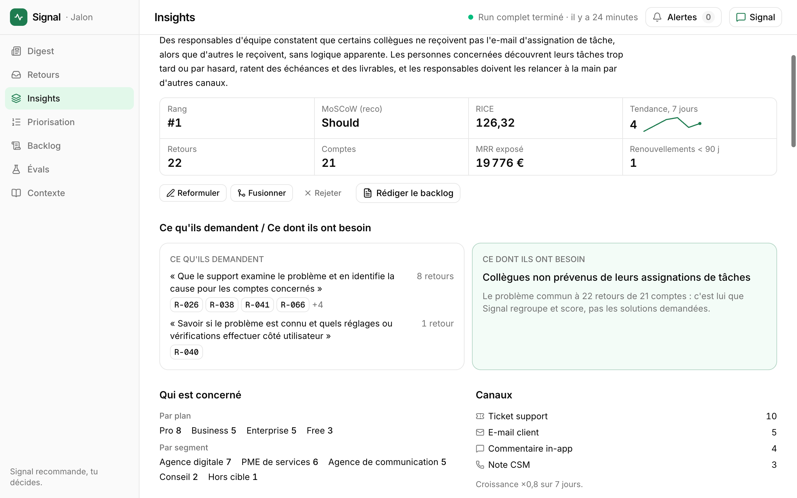
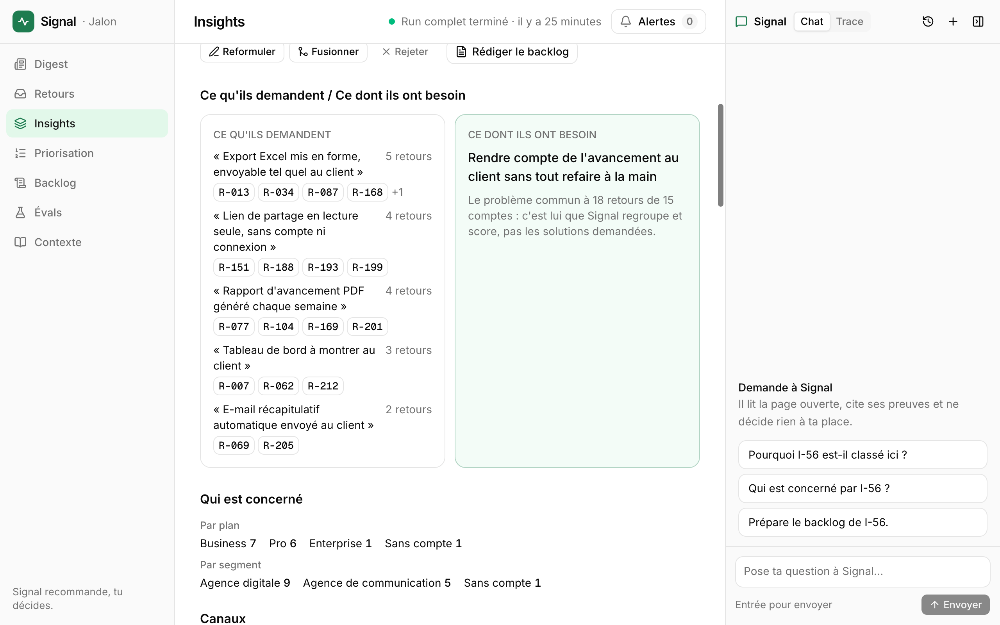
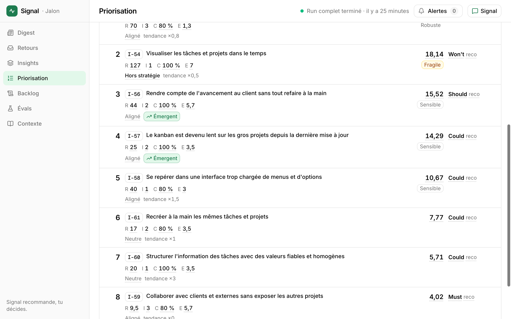
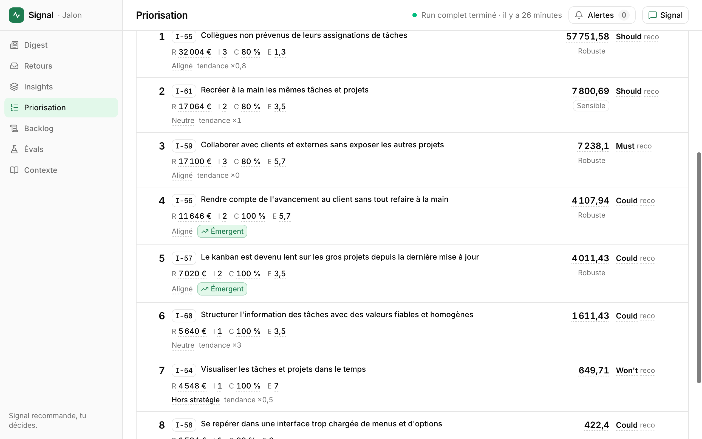
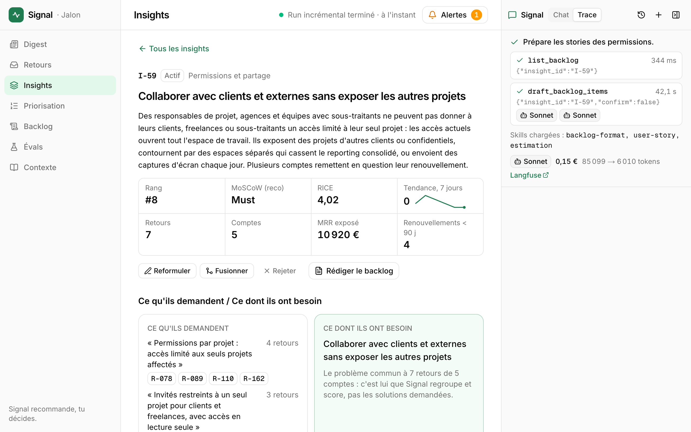
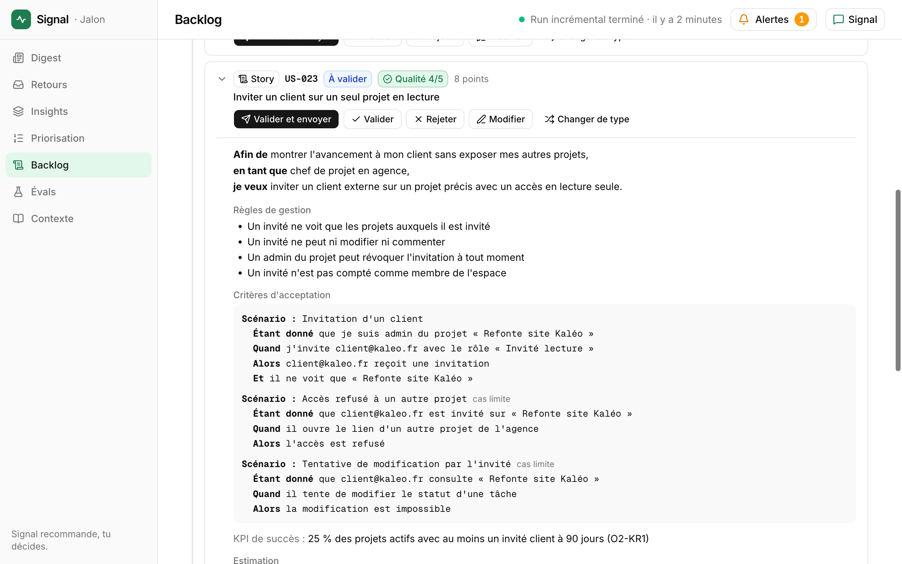
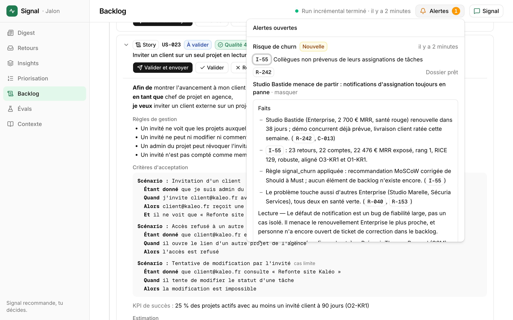
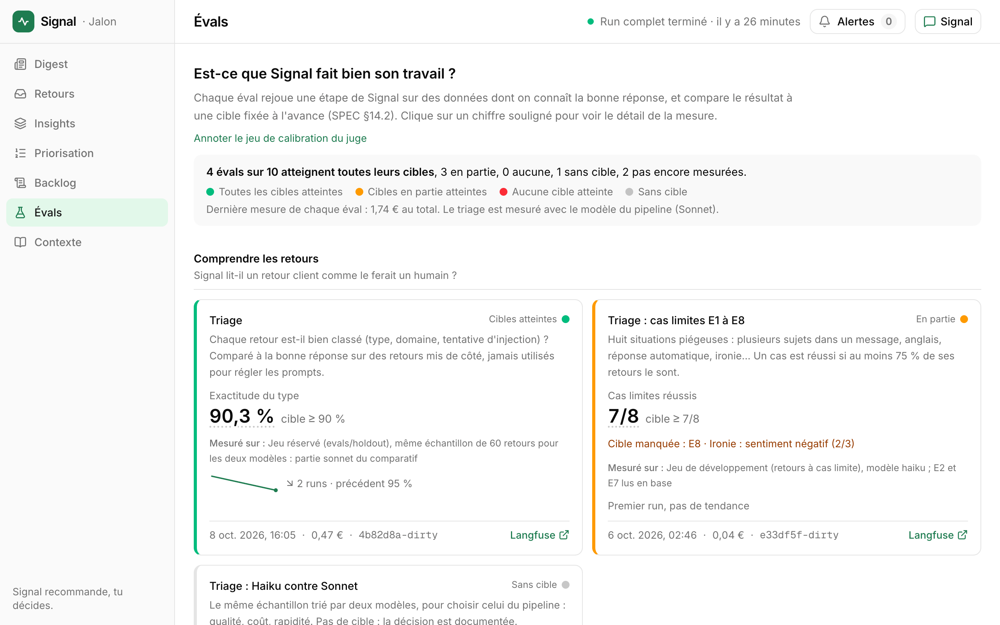

# Signal

[](https://github.com/MrickSvs/signal/actions/workflows/ci.yml)

**Signal filtre le bruit.** C'est l'agent IA de Léa, Product Owner de Jalon, un SaaS fictif de gestion de projet pour agences.
Il lit les retours clients de sept canaux, les découpe par sujet et les regroupe par problème, pas par solution demandée.
Il chiffre chaque sujet (RICE calculé en code, valeur business, MoSCoW sous règles dures), défend son classement preuves à l'appui et challenge une décision qui les contredit.
Il rédige le backlog (stories, bugs, tâches techniques, critères Gherkin, points estimés par analogie) et l'envoie dans le kanban Notion de l'équipe.
Signal recommande, le PO décide : toute décision et toute écriture externe passent par sa validation, et chaque chiffre ouvre sa preuve.

- **Démo en ligne** : [signal-coral-two.vercel.app](https://signal-coral-two.vercel.app), protégée par mot de passe (communiqué à part ; n'importe quel nom d'utilisateur). **Pas besoin d'installer quoi que ce soit** : la [visite libre](#visite-libre-5-minutes) ci-dessous suffit.
- **Pour aller plus loin** : [SPEC.md](SPEC.md) (quoi et pourquoi), [docs/ARCHITECTURE.md](docs/ARCHITECTURE.md), [docs/DECISIONS.md](docs/DECISIONS.md) (44 décisions d'architecture), [docs/EVALS.md](docs/EVALS.md). La méthode de construction est dans [docs/process/](docs/process/) (plan, journal, revue).

## En deux minutes

**Le problème.** Léa reçoit plus de 150 retours par mois, sur sept canaux : e-mails, tickets, commentaires in-app, NPS, notes des CSM et des sales, Slack. Personne ne lit tout ; c'est le plus bruyant qui gagne : trente comptes gratuits qui demandent un Gantt pèsent plus que trois comptes Enterprise sur le point de partir ; et transformer un problème en stories prend des heures.

**La réponse.** Un copilote, pas un pilote automatique :

1. **Comprendre** : chaque retour est trié et découpé en sujets ; Signal distingue la demande exprimée (« un export Excel ») du problème sous-jacent (« rendre compte de l'avancement à mon client »), et regroupe les retours par problème.
2. **Décider** : chaque problème est chiffré en RICE, avec un Reach pondéré par le plan ou par le MRR, puis classé en MoSCoW sous des règles dures (engagements contractuels, risque de départ, stratégie). Signal objecte, preuves à l'appui, quand une décision les contredit.
3. **Livrer** : Signal rédige le backlog au bon format, estime chaque élément par analogie avec les tickets déjà livrés, et l'envoie dans Notion après validation.

**Le principe qui tient le tout** : le modèle lit, juge et rédige ; le code compte, calcule et vérifie ; Léa décide. Aucun score n'est produit par un LLM : le modèle ne fournit que l'Impact, avec ses preuves, et tout le reste est calculé en code.

**Mesuré, pas supposé** ([docs/EVALS.md](docs/EVALS.md)) :

| Ce qu'on mesure | Résultat | Cible |
| --- | --- | --- |
| Triage, sur un jeu réservé jamais utilisé pour régler les prompts | type juste 90,3 % · domaine (macro-F1) 0,91 · injections détectées 100 % | 90 % · 0,85 · 100 % |
| Garde-fous de l'agent (injection, chiffres sourcés, ID existants, validation avant Notion…) | 6 / 6 | 6 / 6 |
| Juge qualité du backlog (Opus), calibré à l'aveugle sur des annotations humaines | 86 % des notes à 1 point ou moins de l'humain · κ de Cohen 0,71 | 80 % · 0,60 |
| Détection des sept problèmes cachés dans le jeu de données | 7 / 8 ❌ (réglée et mesurée sur le même jeu : chiffre optimiste) | 8 / 8 |
| Estimation, en leave-one-out sur les tickets livrés | 70 % des points réels dans la fourchette ✅, mais 0,9 cran d'erreur contre 0,3 pour l'équipe ❌ | 70 % |

Et : **829 tests**, sans aucun appel réseau ; un run complet sur 214 retours en 7 minutes pour **2,52 €** ; un tour de chat à environ 2 centimes.

## Couverture du sujet

| Attendu | Où dans Signal | Comment on le prouve |
| --- | --- | --- |
| **Traiter les retours** (e-mails, tickets, commentaires) | Pipeline : triage et découpage en sujets, rattachement au compte ; écran Retours ; ajout en direct | `eval:triage` sur un jeu réservé |
| **Identifier patterns et tendances** | Regroupement par problème (vecteurs du problème extrait, seuil mesuré) ; tendance émergente ; alertes ; digest du matin | `eval:detection` |
| **Extraire les demandes de fonctionnalités** | « Ce qu'ils demandent » face à « ce dont ils ont besoin » sur chaque insight | `eval:triage`, `eval:detection` |
| **Scorer selon plusieurs critères** | RICE hybride : Reach pondéré (plan ou MRR), Impact jugé, Confidence calculée, Effort estimé ; alignement sur les OKRs ; robustesse du rang | tests à 100 % sur le calcul, `eval:stability` |
| **Appliquer des frameworks** (MoSCoW, RICE) | RICE en code ; MoSCoW recommandé par le modèle, contrôlé par des règles dures ; capacité des Must ≤ 60 % ; règles dans des skills éditables | tests unitaires |
| **Expliquer et justifier** | Chaque chiffre s'ouvre sur son calcul ou ses retours ; recommandations de Signal ; challenge dans le chat ; journal des décisions | `eval:guardrails` |
| **Générer des user stories** | Backlog au format adapté : epic et stories, story seule, bugs, tâche technique, ou rien quand la fonctionnalité existe déjà | badge du juge calibré sur chaque élément |
| **Proposer des critères d'acceptation** | Gherkin en français, avec au moins un cas limite ; règles de gestion | juge (critère « testabilité ») |
| **Estimer la complexité** | Par analogie : carte d'architecture, tickets livrés les plus proches, biais de l'équipe corrigé en code | `eval:estimation` (leave-one-out) |

**Au-delà du sujet** : digest du matin, alertes avec enquête préparée en lecture seule, validation humaine de toute écriture, envoi dans Notion, écran des évals, sujets hors retours (dette technique, pari stratégique).

**Les livrables** : le code (ce dépôt) · la démonstration ([démo en ligne](https://signal-coral-two.vercel.app), [captures](#captures)) · la documentation ([architecture](docs/ARCHITECTURE.md), [décisions](docs/DECISIONS.md), [evals](docs/EVALS.md)) · les tests ([tests et evals](#tests-et-evals)).

## Visite libre (5 minutes)

Sur la [démo en ligne](https://signal-coral-two.vercel.app). Chaque écran répond à une question de PO ; tout chiffre et tout ID s'ouvrent sur leur preuve.

1. **Digest** : qu'est-ce qui a changé depuis ma dernière visite ? S'il n'est pas encore écrit, cliquez sur « Générer le premier digest » (environ 20 s) : l'écran montre les vraies étapes, les faits calculés en code, puis la rédaction par Signal, puis la vérification de chaque ID cité.
2. **Retours** : qu'ont écrit les clients ? Ouvrez un retour : la demande exprimée face au problème sous-jacent, et pourquoi il a été classé ainsi.
3. **Insights** : de quoi parlent-ils, et est-ce que ça monte ? Un insight regroupe des retours par problème, quels que soient les mots et le canal.
4. **Priorisation** : dans quel ordre, et pourquoi ? Comparez le classement en nombre de comptes et en MRR ; ouvrez R, I, C ou E pour voir le calcul ou les preuves.
5. **Évals** et **Contexte** : ce qui est mesuré, ce qui rate, et ce que Signal sait de Jalon (stratégie, engagements, pondérations, skills).

Ces écrans ne font qu'afficher, sauf la génération du digest, qui appelle Claude (quelques centimes).

### Tester avec vos propres données

Ceci appelle Claude (quelques centimes par action) ; rien ne part dans Notion sans validation explicite.

- **Ajouter un retour** (écran Retours) : collez un texte de votre invention, en français ou en anglais, et regardez où Signal le range, avec quel signal. Pour aller plus vite, [dix retours de test](data/demo/retours-a-coller.md) couvrent les cas difficiles, chacun avec le comportement attendu : un compte Enterprise qui menace de partir, un retour en anglais, deux sujets dans le même message, une fonctionnalité qui existe déjà, une tentative d'injection, un sujet inédit, un prospect, de l'ironie, une réponse automatique.
- **Le chat** : demandez pourquoi un sujet est classé là, qui il concerne, ce qui change en MRR ; ou prenez une décision contraire aux chiffres, et voyez Signal la contester avant de vous laisser trancher. L'onglet **Trace** montre les outils et les skills utilisés, et le coût du tour.

## Captures

Sur la base de démo (`pnpm demo:reset`), à 1 280 × 800.

| | |
| --- | --- |
| <br>**Digest du matin** · « À traiter » (trois recommandations avec leurs preuves), comptes à risque, 214 nouveaux retours. | <br>**Génération du digest en direct** · « Régénérer ce digest » : les vraies étapes et leurs chiffres pendant que Sonnet rédige (ADR-044). |
| <br>**Détail d'un insight (I-55)** · Chiffres clés, ce qu'ils demandent face à ce dont ils ont besoin, répartition sur quatre canaux. | <br>**Le problème, pas la solution (I-56)** · Cinq demandes différentes, un seul besoin : c'est lui que Signal regroupe et score. |
| <br>**Priorisation, Reach en comptes** · I-54 (Gantt) 2e, I-59 (permissions) 8e mais Must par règle dure. | <br>**Priorisation, Reach en MRR** · Le même classement pondéré par le revenu : I-59 monte en 3e, I-54 descend en 7e. |
| <br>**Chat, onglet Trace** · Rédaction des stories d'un insight : outils appelés, skills chargées, coût du tour. | <br>**Backlog** · Epic de I-59, une story dépliée : règles de gestion, Gherkin avec cas limites, badge du juge. |
| <br>**Alerte et dossier d'enquête** · Retour collé de Studio Bastide : alerte churn et dossier écrit en lecture seule, faits avec ID. | <br>**Évals** · Est-ce que Signal fait bien son travail ? Chaque éval face à sa cible. |

## Ce qu'il y a dedans

- **Un pipeline** (workflow LangGraph) : triage et découpage des retours en items (Sonnet), rattachement aux comptes, vecteurs Voyage, regroupement agglomératif sur le problème, appariement entre deux runs, étiquetage, estimation par analogie, score, alertes, digest. Run complet en CLI, mode incrémental par route API.
- **Un agent unique** (LangChain v1 `createAgent`) avec 14 outils, un briefing calculé en code à chaque tour, une validation humaine par middleware (carte d'approbation, reprise depuis un checkpointer Postgres) et des enquêtes en lecture seule sur les alertes.
- **Un cockpit** Next.js : Digest, Retours, Insights, Priorisation, Backlog, Évals, Contexte, et le chat avec sa trace en direct.
- **Des evals** rejouables (triage sur un jeu réservé, détection des patterns, estimation en leave-one-out, stabilité, garde-fous, juge Opus calibré sur les annotations du PO).

Détail : [docs/ARCHITECTURE.md](docs/ARCHITECTURE.md).

## Tests et evals

- `pnpm lint && pnpm typecheck && pnpm test` : **829 tests dans 101 fichiers**, sans aucun appel réseau (modèles, Voyage, Notion et Supabase simulés). `pnpm test:coverage` impose 100 % de couverture sur `lib/scoring`, `lib/clustering`, `match.ts` et `mappers.ts`. La CI (GitHub Actions) lance lint, typecheck et couverture, sans aucun secret.
- Les données d'évaluation (`evals/ground-truth/`, `evals/holdout/`) ne sont lisibles que par `scripts/evals/` : règle ESLint et test.
- Evals : `pnpm eval:triage` (`--compare`, `--edge`, `--model sonnet`), `eval:detection`, `eval:estimation`, `eval:stability`, `eval:guardrails` (`--tools`), `eval:judge-calibration`, `eval:backlog`. Elles appellent les vrais modèles : chaque runner annonce son coût et exige `--yes` au-delà de 1 €. Résultats, dates et ce qui n'est pas mesuré : [docs/EVALS.md](docs/EVALS.md), et l'écran Évals.

## Comment il a été construit

Avec un agent de code (Claude Code), piloté comme une équipe :

- **Une spec** ([SPEC.md](SPEC.md)) qui dit quoi et pourquoi, avec sept principes produit et un registre des cas limites ; **un plan** ([PLAN](docs/process/PLAN.md)) découpé en étapes, **une étape par session**.
- **Des règles non négociables** ([CLAUDE.md](CLAUDE.md)) : les calculs sont en code ; tout appel de modèle passe par une seule couche ; la vérité terrain des evals est illisible depuis l'application ; on ne modifie jamais une cible ni un test pour faire passer une étape.
- **Chaque session journalisée** ([BUILD_LOG](docs/process/BUILD_LOG.md) : durée, coût, choix, dettes) et **chaque choix d'architecture écrit** ([44 décisions](docs/DECISIONS.md)) ; une revue complète avant la démo ([REVIEW_NOTES](docs/process/REVIEW_NOTES.md)).

Au total : **50 sessions, environ 21 heures**, et **14 €** d'appels aux modèles de l'application pendant le build (runs du pipeline, evals, essais). `pnpm tsx scripts/build-time.ts` refait ce décompte par phase depuis le journal.

## Limites connues

**Pour passer en production** : masquer les données personnelles avant les modèles (ici, tout est fictif) ; héberger les traitements dans l'UE ; de vrais connecteurs (Zendesk, Intercom, e-mail) ; un pack de contexte par produit et des droits d'accès ; une synchronisation retour avec Notion ; calibrer les hypothèses (facteurs d'extrapolation du Reach) sur de vraies données.

**Échelle** : Signal est dimensionné pour quelques centaines de retours par mois. Trois points cèdent au-delà, chacun avec sa solution :

- **Le classement est recalculé à chaque affichage.** La Priorisation, chaque override et l'outil `get_priority` de l'agent relisent tous les retours (texte compris), items, comptes, analyses et overrides, puis recalculent tout en code. C'est simple et toujours à jour, instantané à 214 retours ; mais le coût grandit avec le volume : à 10 000 retours, chaque affichage transférerait des dizaines de mégaoctets. Solution : stocker les agrégats de chaque insight (comptes par plan, MRR, canaux) et ne les mettre à jour qu'à l'arrivée d'un retour.
- **Le regroupement compare chaque item à tous les autres.** Le clustering agglomératif garde une matrice de distances n × n et la reparcourt à chaque fusion : la mémoire croît en n², le temps en n³. Instantané sur ~250 items, quelques secondes à quelques dizaines de secondes vers 2 000, hors de portée à 10 000 (~100 millions de paires). Solution : un regroupement incrémental qui compare un nouveau retour aux centres des insights existants, comme le fait déjà le mode incrémental, appuyé sur l'index HNSW de pgvector.
- **Le coût du triage** : 0,78 € pour 100 retours avec Sonnet. Haiku 5.5 atteint les cibles pour quatorze fois moins cher, avec un domaine un peu moins juste : à fort volume, il prendrait le relais après une mesure plus large ([ADR-041](docs/DECISIONS.md)). Le traitement de masse passerait aussi par une file d'attente plutôt que par la ligne de commande.

**Non construit** : le prototype visuel d'une story et l'exposition MCP, coupés pour tenir le périmètre ([ADR-031](docs/DECISIONS.md)) ; le retour du statut depuis Notion.

**Ce qui reste fragile** :

- **Evals partielles** : le choix d'outil de l'agent et la qualité agrégée du backlog ne sont pas mesurés ; l'estimation porte sur 10 tickets sur 40, la stabilité sur un seul rejugement ; les cas limites du triage ont été mesurés sur l'ancien modèle de triage.
- **Latences au-dessus du budget** : ajout d'un retour en 15 à 25 s (budget 15 s), rédaction du backlog en ~34 s (budget 30 s).
- **Validation humaine** : sur deux cartes d'approbation, le modèle a rédigé la raison du PO à sa place ; la consigne a été durcie, sans revérification en réel.
- **Les contrôles** empêchent un ID inventé ou un chiffre sans source, pas une affirmation fausse : le texte du digest n'a pas encore d'éval dédiée.
- **Le biais de l'équipe** est moyenné sur tous les composants touchés, ce qui dilue un biais fort (× 1,31 au lieu de × 1,65 pour les permissions).

Le détail, cas limites non traités et dettes techniques compris : [BUILD_LOG](docs/process/BUILD_LOG.md), [REVIEW_NOTES](docs/process/REVIEW_NOTES.md) et SPEC §19.

## Installation

Compter une heure, dont la moitié pour créer les comptes. Toutes les commandes se lancent à la racine du repo.

### 1. Prérequis et comptes

- **Node 22** (`.nvmrc`) et **pnpm 12** (`packageManager` de `package.json` : `corepack enable` suffit). Le CLI Supabase est une dépendance du projet (`pnpm exec supabase`).
- **Anthropic** : une clé API, et un plafond de dépense dans la console.
- **Voyage AI** : une clé API. Sans moyen de paiement, l'API est limitée à 3 requêtes par minute (les 200 M tokens gratuits restent gratuits avec un moyen de paiement).
- **Supabase** : un projet (région UE), et son mot de passe de base (demandé par `supabase link`). L'extension `vector` est créée par la première migration. L'URL et la clé `service_role` sont dans les paramètres d'API du projet ; `DATABASE_URL` est la chaîne du **pooler en mode session** (bouton « Connect » du projet).
- **Langfuse** (facultatif, plan Hobby) : sans clés, rien n'est tracé et tout fonctionne.
- **Notion** (facultatif) : sans Notion, on valide et on rejette les brouillons depuis l'écran Backlog ; seul l'envoi manque.
- **Vercel** (facultatif) : pour déployer ; tout tourne aussi en local.

### 2. Code et variables

```bash
git clone https://github.com/MrickSvs/signal.git && cd signal
pnpm install --frozen-lockfile
cp .env.example .env
```

Renseigner `.env` (chaque variable y est commentée ; valeurs sans guillemets, en local comme sur Vercel : une `LANGFUSE_BASE_URL` entre guillemets a déjà cassé toutes les routes serveur en production) :

| Variable | Pour | Obligatoire |
| --- | --- | --- |
| `ANTHROPIC_API_KEY` | Modèles Claude | oui (pipeline, chat, digest, evals) |
| `VOYAGE_API_KEY` | Embeddings | oui (seed, pipeline, recherche par le sens) |
| `SUPABASE_URL`, `SUPABASE_SERVICE_ROLE_KEY` | Base, côté serveur uniquement | oui |
| `DATABASE_URL` | Verrou du pipeline et mémoire du chat : le **pooler en mode session** (port 5432, IPv4), pas la connexion directe (IPv6 seulement) ni le mode transaction (6543) | oui |
| `LANGFUSE_PUBLIC_KEY`, `LANGFUSE_SECRET_KEY`, `LANGFUSE_BASE_URL`, `LANGFUSE_TRACING_ENVIRONMENT` | Traces, coûts, datasets d'evals | non |
| `NOTION_TOKEN`, `NOTION_PARENT_PAGE_ID`, `NOTION_DS_BACKLOG` | Envoi du backlog validé | non |
| `SITE_PASSWORD` | Basic Auth de l'app (vide : pas de mot de passe) | non |
| `APP_BASE_URL` | Liens poussés dans Notion | avec Notion |
| `CRON_SECRET` | Route du cron quotidien | en déploiement |
| `DEMO_NOW` | Date de référence du scénario (vide : maintenant) | non, laisser vide |

### 3. Base

```bash
pnpm exec supabase login
pnpm exec supabase link --project-ref <ref du projet>
pnpm db:push        # applique les 8 migrations de supabase/migrations/
pnpm db:seed        # 90 clients et 5 prospects, 40 tickets de référence (vectorisés par Voyage), 214 retours
```

Le schéma `langgraph` (mémoire du chat, reprise du pipeline) est créé au premier usage.

### 4. Données : la base de démo, ou un run complet

**Base de démo (recommandé, ~20 s, sans appel de modèle)** : restaure le snapshot versionné dans `data/demo-snapshot/` (214 retours triés, 26 insights déjà revus par le PO dont 25 actifs, scores, estimations), puis écrit le premier digest.

```bash
pnpm demo:reset     # ~15 s, dates recalées sur aujourd'hui (jours du calendrier de Paris)
pnpm digest         # ~15 s, ~0,03 €
```

Le premier digest peut aussi s'écrire depuis l'écran Digest (« Générer le premier digest ») : une page sans digest ne compte pas comme une visite de Léa, donc il couvre tout le scénario. Le cron quotidien (04:00 UTC) écrit aussi un digest : faire le reset après son passage, ou le désactiver ce jour-là, sinon l'écran montre le digest d'une nuit presque vide.

**Ou tout recalculer** : `pnpm pipeline:run` (mesuré le 7 octobre : 214 retours, 410 s, **2,52 €** ; `--resume <run_id>` reprend un run interrompu). Les insights naissent « à valider » : écran Insights, « Tout accepter » ou revue une à une.

### 5. Lancer

```bash
pnpm dev            # http://localhost:3000
```

Sans `SITE_PASSWORD`, aucun mot de passe n'est demandé. Après une modification de l'agent (prompt, outils), redémarrer `pnpm dev` : l'agent compilé est gardé en mémoire.

### 6. Notion (facultatif)

Signal envoie dans Notion les éléments du backlog que le PO a validés, et seulement eux, dans un seul sens (SPEC §11, ADR-026). Une base suffit : **Backlog**, avec sa vue kanban groupée par Statut.

1. **Créer l'intégration** : [notion.so/profile/integrations](https://www.notion.so/profile/integrations) → nouvelle intégration interne, capacités « Lire », « Mettre à jour » et « Insérer du contenu ». Copier le jeton dans `NOTION_TOKEN`.
2. **Partager la page parente** : créer une page « Jalon — Produit (Signal) », puis ••• → Connexions → ajouter l'intégration. Copier l'ID de la page (les 32 caractères à la fin de son URL) dans `NOTION_PARENT_PAGE_ID`.
3. **Lancer le setup** :

   ```bash
   pnpm notion:setup
   ```

   Il crée la base Backlog (Nom, ID, Type, Statut, Epic, Insight, MoSCoW, Points, Énoncé, Prototype, Lien Signal, Validé le) et la vue « Kanban » groupée par Statut, puis affiche `NOTION_DS_BACKLOG=…` à copier dans `.env` (et sur Vercel). Relancé, il ne recrée rien et ajoute seulement les propriétés manquantes.

4. **Si la vue kanban n'a pas pu être créée** (le script le signale) : dans la base, « + Ajouter une vue » → Tableau → Grouper par « Statut ».

L'envoi se fait depuis le chat (« Envoie US-004 dans Notion », carte d'approbation) ou depuis l'écran Backlog (« Valider et envoyer »). En cas d'échec, l'élément reste « validé » avec l'erreur et un bouton « Réessayer ». Une fois envoyé, il se modifie dans Notion.

### 7. Déployer (facultatif)

Projet Vercel à la racine du repo, Fluid compute (300 s au plus par fonction), région `dub1` et cron quotidien déclarés dans `vercel.json`. Reporter les variables dans Vercel, pour chaque environnement qui doit tourner : sur le projet actuel, elles ne sont définies qu'en Production, et un déploiement Preview tourne sans base ni clés. Les runs complets du pipeline restent en CLI.

## Commandes

Le tableau complet, avec les options, est dans [CLAUDE.md](CLAUDE.md#commandes).

| Commande | Effet |
| --- | --- |
| `pnpm dev` | Lancer l'app |
| `pnpm lint` · `pnpm typecheck` · `pnpm test` · `pnpm test:coverage` | Qualité (aucune clé nécessaire) |
| `pnpm db:push` · `pnpm db:seed` · `pnpm db:types` | Base |
| `pnpm pipeline:run` · `pipeline:triage` · `pipeline:enrich` · `pipeline:cluster` · `pipeline:score` · `pnpm digest` | Pipeline, en entier ou nœud par nœud |
| `pnpm chat` · `pnpm investigate <alert_uuid>` (`--pending`) · `pnpm estimate I-xx` | L'agent, une enquête, une estimation, en terminal |
| `pnpm notion:setup` | Base Backlog dans Notion |
| `pnpm eval:*` | Evals (voir plus bas) |
| `pnpm demo:snapshot` · `pnpm demo:reset` (`--empty`) | Figer la base de démo, la restaurer (ou la vider) |
| `pnpm tsx scripts/build-time.ts` | Temps et coût LLM du build par phase, depuis le journal |

## Structure

```
.
├── SPEC.md · CLAUDE.md · README.md
├── src/
│   ├── app/                 # écrans et routes API (agent, pipeline incrémental, digest, cron)
│   ├── agent/               # agent unique, prompt système, briefing, middlewares, HITL, enquêtes
│   │   └── tools/           # un fichier par outil (14)
│   ├── pipeline/            # graphe LangGraph, mode incrémental, verrou ; nodes/ : un nœud par fichier
│   ├── services/            # priorisation, revue des insights, backlog, estimation, alertes, notion/
│   ├── server/              # queries/ (lectures) et actions/ (server actions)
│   ├── lib/                 # llm, embeddings, scoring, clustering, estimation, insights, judge, evals…
│   └── components/          # écrans, chat, puces d'aperçu, ui/ (shadcn)
├── scripts/                 # CLI : seed, génération, pipeline, chat, Notion, démo ; evals/ : runners
├── context/jalon/           # pack de contexte et 9 skills
├── data/                    # scénario, clients, retours, tickets ; demo/ et demo-snapshot/
├── evals/                   # ground-truth/, holdout/, human-labels/, reports/ (lus par scripts/evals seulement)
├── supabase/migrations/     # 8 migrations, en ajout seulement
└── docs/                    # ARCHITECTURE, DECISIONS, EVALS, img/ ; process/ : PLAN, BUILD_LOG, REVIEW_NOTES
```
